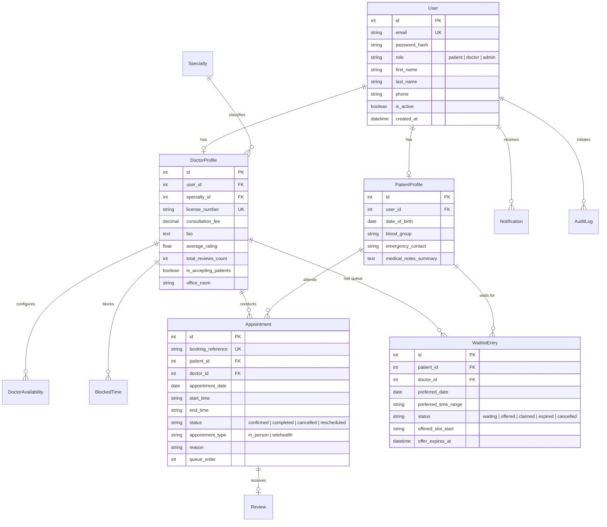

# MediSync AI — Intelligent Healthcare Appointment, Scheduling & Patient Coordination Platform

> Final-Year Academic & Portfolio Project in Applied Healthcare Informatics and Scalable Full-Stack Engineering.

MediSync AI connects patients, physicians, and clinic administrators through an intelligent, transparent coordination platform. Unlike generic booking portals, MediSync AI solves critical healthcare bottlenecks including double-booking hazards, unpredictable waiting-room delays, high cancellation attrition, and clinical workload imbalance.

---

## 1. Core Architecture & System Features

1. **Intelligent Doctor Discovery**: Multi-criteria weighted recommendation algorithm (Specialty compatibility 40%, slot fit 25%, time preference 20%, verified patient rating 15%) with human-readable rationale explanations.
2. **Smart Appointment Engine**: Database-level concurrency control, duration validation, past-date booking prevention, and working-hour compliance.
3. **Waitlist & Slot Recovery Engine**: Automatically detects cancellations, checks prioritized waitlist queues, issues time-bounded offers (2-hour window), and recovers empty clinical slots without double-allocation.
4. **Queue & Waiting-Time Estimation**: Calculates transparent patient queue positions, patients ahead, and estimated wait times based on historical consultation pacing with clinical variance disclaimers.
5. **Role-Based Access Control (RBAC)**: Secure access tailored for Patients, Doctors, and Administrators.
6. **Healthcare Operational Analytics**: Daily/weekly appointment demand trends, specialty distributions, doctor workload volume, cancellation rates, and CSV export.

---

## 2. Database Architecture (Entity-Relationship Diagram)



---

## 3. Technology Stack

- **Backend**: Python 3.10+, Flask 3.0, Flask-SQLAlchemy, Flask-Migrate, Flask-Login, Flask-CORS.
- **Data & Analytics**: SQLAlchemy 2.0, Pandas, NumPy.
- **Database**: PostgreSQL (Production) / SQLite (Zero-config local development).
- **Frontend**: Modern React 19 + TypeScript + Vite + Tailwind CSS + Lucide Icons.
- **Testing**: pytest & Python unittest test client.
- **Containerization**: Docker, Docker Compose, Gunicorn WSGI.

---

## 4. Setup & Installation Instructions

### Prerequisites
- Python 3.10+
- Node.js 18+ (for frontend)
- Git

### A. Python Backend Setup
```bash
# 1. Navigate to backend directory
cd backend

# 2. Create virtual environment
python3 -m venv venv
source venv/bin/activate  # On Windows: venv\Scripts\activate

# 3. Install dependencies
pip install -r requirements.txt

# 4. Configure environment
cp .env.example .env

# 5. Populate synthetic database
python scripts/seed_data.py

# 6. Run automated tests
pytest tests/ -v

# 7. Start the Flask API
python app.py
```
The API server runs at `http://localhost:5000`.

### B. Running with Docker Compose
```bash
docker-compose up --build
```
This automatically provisions PostgreSQL 15, initializes schemas, seeds synthetic clinical data, and serves the Flask app via Gunicorn on port 5000.

---

## 5. REST API Specifications

| Method | Endpoint | Description | Auth Required |
|---|---|---|---|
| `POST` | `/api/auth/register` | Register new patient account | None |
| `POST` | `/api/auth/login` | Session login with password verification | None |
| `POST` | `/api/auth/logout` | Terminate session | Yes |
| `GET` | `/api/auth/me` | Fetch active authenticated user | Yes |
| `GET` | `/api/doctors` | List doctors with specialty/name search | None |
| `GET` | `/api/doctors/recommend` | Multi-criteria recommendation engine | None |
| `GET` | `/api/doctors/<id>/availability` | Real-time computed open slots | None |
| `POST` | `/api/appointments` | Book appointment with atomic validation | Patient/Admin |
| `GET` | `/api/appointments` | List scoped appointments | Yes |
| `GET` | `/api/appointments/<id>` | Details & queue wait-time estimate | Yes |
| `POST` | `/api/appointments/<id>/cancel` | Cancel booking & trigger waitlist | Yes |
| `POST` | `/api/appointments/<id>/reschedule` | Reschedule booking | Yes |
| `POST` | `/api/waitlist` | Join queue for target date/time window | Patient |
| `POST` | `/api/waitlist/<id>/claim` | Confirm and claim recovered slot | Patient |
| `GET` | `/api/analytics/overview` | Macro operational KPIs | Admin/Doctor |
| `GET` | `/api/analytics/export-csv` | Stream clinical appointment logs CSV | Admin |

---

## 6. Pre-Configured Demonstration Accounts

| Role | Email | Password | Details |
|---|---|---|---|
| **Administrator** | `admin@medisync.io` | `AdminPass123!` | Executive Hospital Operations Lead |
| **Doctor (Cardiology)** | `sarah.chen@medisync.io` | `DoctorPass123!` | Dr. Sarah Chen, MD |
| **Doctor (Neurology)** | `marcus.vance@medisync.io` | `DoctorPass123!` | Dr. Marcus Vance, MD |
| **Doctor (Pediatrics)** | `elena.rodriguez@medisync.io` | `DoctorPass123!` | Dr. Elena Rodriguez, MD |
| **Patient** | `patient.emma@example.com` | `PatientPass123!` | Emma Watson |
| **Patient** | `patient.david@example.com` | `PatientPass123!` | David Kim |

---

## 7. Compliance & Clinical Ethics Notice

MediSync AI is engineered for appointment coordination, workflow optimization, and waiting-room logistics. **It does not provide diagnostic predictions, prescribe medical therapies, or replace licensed physician consultation.** In emergency conditions, patients must always contact local emergency services immediately.
